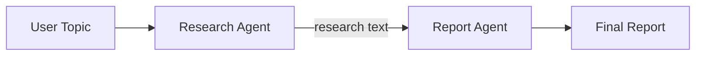
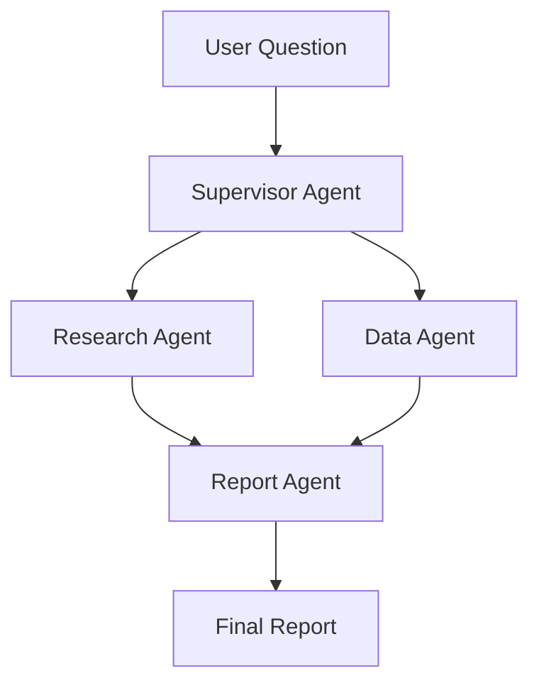

# Multi-Agent Business Assistant

A multi-agent AI system built with **LangGraph** that automates a common business workflow: researching a topic on the web and turning the findings into a clear, professional report.

> **Status:** Version 1 (working demo). Research Agent and Report Agent are implemented. Data Agent and Supervisor Agent are planned (see [Roadmap](#roadmap)).

---

## Table of Contents

- [Overview](#overview)
- [Problem Statement](#problem-statement)
- [Real-World Use Cases](#real-world-use-cases)
- [Features](#features)
- [Architecture](#architecture)
- [Agents in Detail](#agents-in-detail)
- [Tech Stack](#tech-stack)
- [Project Structure](#project-structure)
- [Getting Started](#getting-started)
- [Configuration](#configuration)
- [Usage](#usage)
- [Sample Output](#sample-output)
- [How It Works (Step by Step)](#how-it-works-step-by-step)
- [Troubleshooting](#troubleshooting)
- [Roadmap](#roadmap)
- [Limitations](#limitations)
- [What I Learned](#what-i-learned)
- [Author](#author)

---

## Overview

Business teams spend hours researching markets, competitors and trends, and then more time writing the results into a report. This project shows how a small team of AI agents can split that work:

1. A **Research Agent** collects up-to-date information from the web.
2. A **Report Agent** turns that research into a structured business report.

The agents are connected as a graph using LangGraph and share a common state, so each agent can build on the previous agent's output.

---

## Problem Statement

Manual business research has three main problems:

| Problem | Description |
|---------|-------------|
| **Slow** | Searching, reading and summarizing sources takes hours. |
| **Inconsistent** | Every person writes reports in a different format. |
| **Repetitive** | The same steps are repeated for every new topic. |

This assistant automates the workflow: the user enters a topic and receives a structured report in minutes.

---

## Real-World Use Cases

- **E-commerce owner:** quickly understand competitors and market trends before launching a product.
- **Marketing manager:** prepare a weekly or monthly market-research summary.
- **Startup founder:** gather background research before an investor or client meeting.
- **Freelancer / consultant:** produce a first-draft research report for a client.

---

## Features

- Web research using the **Tavily Search API**
- Report generation with a **Groq-hosted LLM**
- Stateful multi-agent workflow built with **LangGraph**
- Structured report format: Summary, Key Points, Recommendation
- Report is grounded in retrieved research instead of the model's memory alone
- Modular design: every agent lives in its own file and is easy to extend

---

## Architecture



### Shared State

All agents read from and write to one shared state object:

| Field      | Type  | Written by      | Description                              |
|------------|-------|-----------------|------------------------------------------|
| `topic`    | `str` | User input      | The topic entered by the user            |
| `research` | `str` | Research Agent  | Combined text of the web search results  |
| `report`   | `str` | Report Agent    | The final report                         |

### Planned Architecture (Version 2)



---

## Agents in Detail

### 1. Research Agent
- **Input:** `topic`
- **Tool:** Tavily Search API (top 5 results)
- **Output:** `research` (combined text of the results)
- **File:** `agents/research_agent.py`

### 2. Report Agent
- **Input:** `topic` and `research`
- **Model:** Groq-hosted LLM (via `langchain-groq`)
- **Behavior:** writes the report using only the supplied research, to reduce made-up information
- **Output:** `report` in the format Summary, Key Points, Recommendation
- **File:** `agents/report_agent.py`

---

## Tech Stack

| Layer            | Technology                  |
|------------------|-----------------------------|
| Language         | Python 3.10+                |
| Agent framework  | LangGraph                   |
| LLM              | Groq (via `langchain-groq`) |
| Web search       | Tavily                      |
| Config / secrets | python-dotenv               |

---

## Project Structure

```
multi_agent_assistant/
├── agents/
│   ├── __init__.py
│   ├── research_agent.py    # Searches the web with Tavily
│   └── report_agent.py      # Writes the report with the LLM
├── graph.py                 # Builds and compiles the LangGraph workflow
├── state.py                 # Shared state definition
├── main.py                  # Entry point (command line)
├── requirements.txt         # Python dependencies
├── .env.example             # Example environment variables
├── .gitignore               # Keeps .env and venv out of Git
└── README.md
```

---

## Getting Started

### Prerequisites

- Python 3.10 or higher
- A [Groq](https://console.groq.com) API key
- A [Tavily](https://tavily.com) API key
- Git

### Installation

```bash
# 1. Clone the repository
git clone https://github.com/<your-username>/multi_agent_assistant.git
cd multi_agent_assistant

# 2. Create a virtual environment
python -m venv venv

# 3. Activate it
# Windows
venv\Scripts\activate
# macOS / Linux
source venv/bin/activate

# 4. Install dependencies
pip install -r requirements.txt
```

### `requirements.txt`

```
langgraph
langchain-groq
langchain-community
tavily-python
python-dotenv
```

---

## Configuration

Copy `.env.example` to `.env` and add your own keys:

```
GROQ_API_KEY=your_groq_api_key
TAVILY_API_KEY=your_tavily_api_key
```

> **Important:** never commit your `.env` file. Make sure `.env` and `venv/` are listed in `.gitignore`.

---

## Usage

```bash
python main.py
```

Enter a topic when prompted:

```
Topic: AI trends in Pakistan e-commerce
```

The assistant researches the topic and prints a report.

---

## Sample Output

The report follows this structure (example format):

```
Summary
A short paragraph describing the topic and the main findings.

Key Points
- Point 1 based on the research
- Point 2 based on the research
- Point 3 based on the research

Recommendation
A short, practical recommendation based on the findings.
```

> Replace this section with a real screenshot or output from your own run.

---

## How It Works (Step by Step)

1. **Input:** the user enters a topic, which is stored in the shared state.
2. **Research Agent:** sends the topic to Tavily, collects the top results and saves the combined text in `research`.
3. **Report Agent:** receives the research and prompts the LLM to write a report using only that information.
4. **Output:** the final report is stored in `report` and printed to the user.

The flow is defined in `graph.py` with LangGraph's `StateGraph`:
`START → research → report → END`.

---

## Troubleshooting

| Problem | Possible fix |
|---------|--------------|
| `ModuleNotFoundError: agents` | Create an empty `agents/__init__.py` file. |
| API key error | Check that `.env` exists in the project root and the key names match exactly. |
| Model not found (Groq) | Groq model names change over time. Check the current list in the Groq console and update the model name in `report_agent.py`. |
| Empty or weak report | Try a more specific topic, or increase `max_results` in `research_agent.py`. |

---

## Roadmap

- [x] Research Agent (Tavily web search)
- [x] Report Agent (Groq LLM)
- [x] LangGraph workflow with shared state
- [ ] Data Agent for CSV / SQL analysis
- [ ] Supervisor Agent to route tasks between agents
- [ ] Streamlit user interface
- [ ] FastAPI backend
- [ ] Source citations in the report
- [ ] Automatic evaluation of report quality

---

## Limitations

- Report quality depends on the quality of the search results.
- This is a demo and is not production-ready (no authentication, rate limiting or monitoring).
- Only web research is supported right now; internal company data is not connected yet.
- The LLM can still make mistakes, so important facts should be verified.

---

## What I Learned

- Designing a multi-agent workflow with LangGraph and a shared state
- Connecting an LLM with an external search tool
- Writing prompts that keep the model grounded in the provided context
- Structuring an AI project so each agent is modular and reusable

---

## Author

**Mahnoor**
AI Developer | Python, LLMs, RAG, LangGraph

- GitHub: `<https://github.com/nmah7822>`
- LinkedIn: `<https://www.linkedin.com/in/mahnoor14>`

---

If you find this project useful, consider giving it a star.